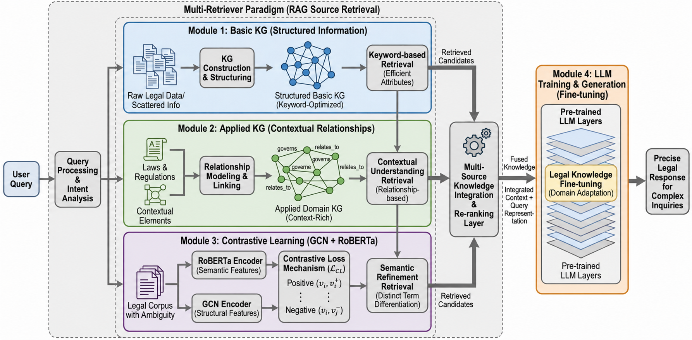
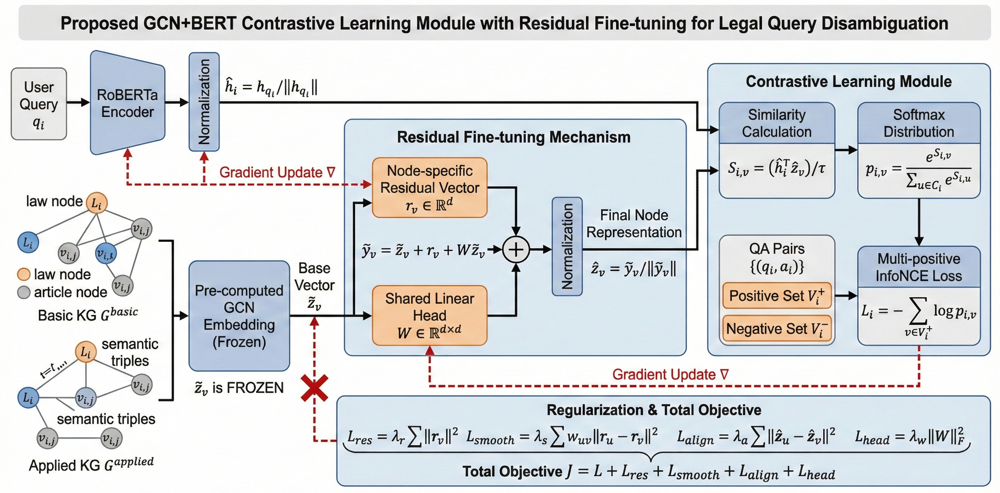
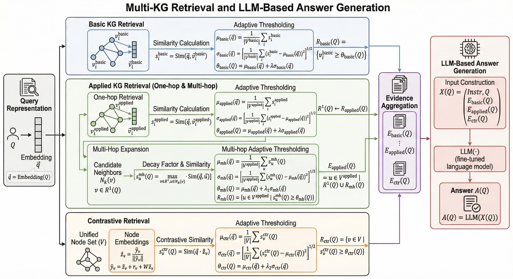
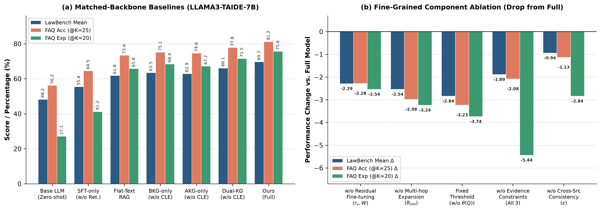
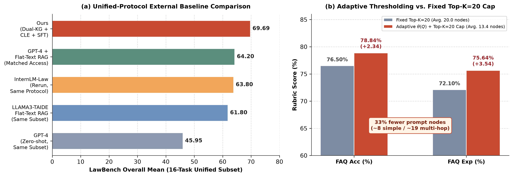

<div align="center">

# Beyond Flat Legal RAG: Contrastive Dual-Graph Retrieval for Citation-Grounded Legal Question Answering

[-1E5AA8?style=flat-square)](https://link.springer.com/journal/530)
[](https://www.python.org/)
[](https://pytorch.org/)
[](https://huggingface.co/taide)
[](LICENSE)

**Wan-Chi Yang**<sup>1</sup> · **Ming-Juinn Li**<sup>2</sup> · **Diptendu Sinha Roy**<sup>3</sup> · **Chih-Yung Chang**<sup>2,*</sup>

<sup>1</sup>National Taipei University of Nursing and Health Sciences &nbsp;|&nbsp;
<sup>2</sup>Tamkang University &nbsp;|&nbsp;
<sup>3</sup>National Institute of Technology Meghalaya

[Architecture](#-architecture-overview) • [Key Results](#-key-experimental-results) • [Equation-to-Code Map](#-paper-equation-to-code-mapping) • [Quickstart](#-quickstart) • [Ablations](#-running-ablation-presets) • [Citation](#-citation)

</div>

---

## ✨ Highlights

Conventional legal Retrieval-Augmented Generation (RAG) splits statutes into **flat text chunks**, destroying law–article hierarchy and cross-references while failing to bridge colloquial user queries with formal statutory provisions. **Contrastive Dual-Graph Legal RAG** resolves these limitations across **labor**, **insurance**, and **financial** law through four tightly coupled modules:

- **🏛️ Module 1 — Basic Knowledge Graph (`Basic KG`)**: Preserves authoritative law–article star topology ($L_i \to v_{i,j} = (\varphi_{i,j}, \mathrm{Case}_{i,j})$) keeping internal paragraphs/subparagraphs intact alongside linked judicial decisions, routed via an **SVM + Platt scaling** domain classifier.
- **💬 Module 2 — Applied Knowledge Graph (`Applied KG`)**: Bridges everyday user language and statutory concepts via Jieba segmentation, BM25 keyword extraction, legal synonym expansion $S(\cdot)$, statutory-prefix answer revision, and semantic triple aggregation $\Phi^{\mathrm{text}}$.
- **🎯 Module 3 — Residual Contrastive Alignment (`GCN + RoBERTa`)**: Freezes pretrained GCN structural vectors $\tilde{z}_v$ and learns regularized node residuals $r_v$ plus a shared linear head $W$ ($\tilde{y}_v = \tilde{z}_v + r_v + W\tilde{z}_v$) under a **multi-positive InfoNCE** objective with residual, graph-smoothness, cross-graph alignment, and head-decay regularizers.
- **🧭 Uncertainty-Gated Adaptive Retrieval & Evidence-Constrained LoRA SFT**: Decouples query-adaptive similarity thresholding ($\theta(Q) = \mu + \lambda\sigma$) and entropy-gated bounded one-/two-hop expansion ($U(Q)$, $h^*(Q) \in \{1,2\}$) from the **Top-$K$ context budget ceiling**, enforced with **coverage**, **cross-source consistency**, and **entropy redundancy** constraints to fine-tune `LLAMA3-TAIDE-7B`.

---

## 🏗️ Architecture Overview

<div align="center">
  
  <p><em>Figure 1: Overall four-module Contrastive Dual-Graph Legal RAG framework.</em></p>
</div>

<details>
<summary><b>🔍 Expand Detailed Diagrams: Residual Contrastive Module (Fig. 4) & Inference Pipeline (Fig. 6)</b></summary>
<br/>
<div align="center">
  
  <p><em>Figure 4: Frozen-base GCN + RoBERTa residual contrastive alignment with multi-positive InfoNCE and four structural regularizers.</em></p>
  <br/>
  
  <p><em>Figure 6: Inference-stage query-adaptive thresholding, uncertainty-gated bounded multi-hop expansion, contrastive retrieval, and citation-grounded generation.</em></p>
</div>
</details>

---

## 📊 Key Experimental Results

### 1. Matched-Backbone Progression & Fine-Grained Ablation (`LLAMA3-TAIDE-7B`)

| Exp ID | Configuration | LawBench Mean (16 Tasks) | FAQ Acc (@K=25) | FAQ Exp (@K=20) |
| :--- | :--- | :---: | :---: | :---: |
| `Exp 1-1` | Base LLM (Zero-shot, no retrieval) | 48.20 | 56.22% | 27.14% |
| `Exp 1-2` | SFT-only (w/o Retrieval) | 55.40 | 64.50% | 41.20% |
| `Exp 1-3` | Strong Flat-Text RAG (Dense + BM25 + Rerank) | 61.80 | 73.40% | 65.80% |
| `Exp 1-4` | Single-KG RAG (BKG-only, w/o CLE) | 63.50 | 75.10% | 68.40% |
| `Exp 1-5` | Single-KG RAG (AKG-only, w/o CLE) | 62.90 | 74.60% | 67.20% |
| `Exp 1-6` | Dual-KG RAG (BKG + AKG, w/o CLE) | 66.10 | 77.80% | 71.50% |
| `Exp 2-1` | w/o Residual Fine-tuning ($r_v, W$, Eq. 34) | 67.40 (-2.29) | 78.90% (-2.28) | 73.10% (-2.54) |
| `Exp 2-2` | w/o Multi-hop Expansion ($R_{\mathrm{mh}}$, Eqs. 61–67) | 67.15 (-2.54) | 78.20% (-2.98) | 72.40% (-3.24) |
| `Exp 2-3` | Fixed Threshold (w/o Adaptive $\theta(Q)$) | 66.85 (-2.84) | 77.95% (-3.23) | 71.90% (-3.74) |
| `Exp 2-4` | w/o Evidence Constraints (All 3, Eqs. 31–33) | 67.80 (-1.89) | 79.10% (-2.08) | 70.20% (-5.44) |
| `Exp 2-5` | w/o Cross-Source Consistency ($\epsilon$, Eq. 32) | 68.75 (-0.94) | 80.05% (-1.13) | 72.80% (-2.84) |
| **`Full`** | **Ours (`BKG + AKG + CLE + SFT`)** | **69.69** | **81.18%** | **75.64%** |

<div align="center">
  
</div>

### 2. Unified-Protocol External Reruns & Adaptive Budget Decoupling

| Unified-Protocol External Baseline (Same 16-Task Subset) | LawBench Mean | | Adaptive Thresholding vs. Fixed Top-K=20 (FAQ) | Avg. Nodes | FAQ Acc | FAQ Exp |
| :--- | :---: | :---: | :--- | :---: | :---: | :---: |
| `Exp 3-1` GPT-4 (Zero-shot, Same Subset) | 45.95 | | `Exp 4-1` Fixed Top-$K$=20 (w/o Adaptive $\theta(Q)$) | 20.0 | 76.50% | 72.10% |
| `Exp 1-3` LLAMA3-TAIDE-7B + Flat-Text RAG | 61.80 | | **`Exp 4-2` Adaptive $\theta(Q)$ + Top-$K$=20 Cap (Ours)** | **13.4** | **78.84%** | **75.64%** |
| `Exp 3-3` InternLM-Law (Rerun, Same Protocol) | 63.80 | | *(33.0% fewer prompt nodes: ~8 simple / ~19 multi-hop)* | **-33.0%** | **+2.34 pp** | **+3.54 pp** |
| `Exp 3-2` GPT-4 + Flat-Text RAG (Matched Access) | 64.20 | | | | | |
| **`Full` Ours (`LLAMA3-TAIDE-7B` + Dual-KG + CLE)** | **69.69** | | | | | |

<div align="center">
  
</div>

---

## 🗺️ Paper Equation-to-Code Mapping

| Paper Section / Equations | Algorithm / Component | Implementation File |
| :--- | :--- | :--- |
| Sec. 3.1–3.3, Eqs. (1)–(30) | Answerability F1, Article-level F1, Semantic $\rho$, Joint $P_M$ | [`src/dual_graph_lqa/evaluation/metrics.py`](src/dual_graph_lqa/evaluation/metrics.py) |
| Sec. 3.4 & 4.4, Eqs. (31)–(33) | Coverage ($\delta_{\mathrm{cov}}$), Cross-Source Consistency ($\epsilon$), Redundancy ($\delta_{\mathrm{ent}}$) | [`src/dual_graph_lqa/retrieval/constraints.py`](src/dual_graph_lqa/retrieval/constraints.py) |
| Sec. 4.1, Algorithm 1 (Table 2) | Basic KG Construction + SVM & Platt Scaling Domain Router | [`src/dual_graph_lqa/kg/basic_kg.py`](src/dual_graph_lqa/kg/basic_kg.py), [`domain_router.py`](src/dual_graph_lqa/kg/domain_router.py) |
| Sec. 4.2, Algorithm 2 (Table 3) | Applied KG (Jieba, BM25, Synonym Expansion, Answer Revision, Triples) | [`src/dual_graph_lqa/kg/applied_kg.py`](src/dual_graph_lqa/kg/applied_kg.py) |
| Sec. 4.3, Algorithm 3 (Table 4), Eqs. (34)–(49) | Frozen GCN + RoBERTa Residual Contrastive Alignment (Multi-Positive InfoNCE) | [`src/dual_graph_lqa/contrastive/residual_alignment.py`](src/dual_graph_lqa/contrastive/residual_alignment.py), [`gcn_encoder.py`](src/dual_graph_lqa/contrastive/gcn_encoder.py) |
| Sec. 4.4, Algorithm 4 (Table 5), Eq. (50) | Evidence Prompt Assembly & `LLAMA3-TAIDE-7B` LoRA SFT (Table 10) | [`src/dual_graph_lqa/llm/sft_trainer.py`](src/dual_graph_lqa/llm/sft_trainer.py), [`prompt_builder.py`](src/dual_graph_lqa/llm/prompt_builder.py) |
| Sec. 4.5, Algorithm 5 (Table 6), Eqs. (51)–(77) | Adaptive Thresholding, Entropy $U(Q)$, Bounded Stopping $h^*(Q)$, Top-$K$ Cap | [`src/dual_graph_lqa/retrieval/adaptive_retriever.py`](src/dual_graph_lqa/retrieval/adaptive_retriever.py) |
| Sec. 5.1, Safeguards S1–S4 | 4-Stage Anti-Leakage Deduplication & Paraphrase Quarantine | [`src/dual_graph_lqa/data/anti_leakage.py`](src/dual_graph_lqa/data/anti_leakage.py) |
| Sec. 5.3.1 & 5.3.3 (Exp 1-3, Exp 3-2) | Strong Flat-Text Hybrid RAG Baseline (Dense + BM25 + RRF Rerank) | [`src/dual_graph_lqa/retrieval/flat_rag_baseline.py`](src/dual_graph_lqa/retrieval/flat_rag_baseline.py) |
| Sec. 5.3.2 & 5.3.3 (Tables 7 & 13) | 16-Task LawBench Adapter & 6-Level FAQ Rubric Judge | [`src/dual_graph_lqa/evaluation/lawbench_adapter.py`](src/dual_graph_lqa/evaluation/lawbench_adapter.py), [`faq_rubric_judge.py`](src/dual_graph_lqa/evaluation/faq_rubric_judge.py) |

---

## 🚀 Quickstart

### 1. Installation

```bash
git clone https://github.com/7WD1/WanChiPaper1.git
cd WanChiPaper1

# Lightweight CPU smoke-test environment (runs full architecture end-to-end)
pip install numpy pyyaml networkx

# Full GPU training & inference environment (CUDA 12.1, LLAMA3-TAIDE-7B + RoBERTa + LoRA)
pip install -r requirements.txt
```

### 2. Run the End-to-End Pipeline (Works Out-of-the-Box on Included Sample Legal Corpus)

```bash
# Step 1: Anti-leakage audit (S1-S4) + Build Basic KG, Applied KG & SVM+Platt Router
python scripts/build_dual_kg.py --config configs/default.yaml

# Step 2: Train GCN + Residual Contrastive Alignment (Module 3, Eqs. 34-49)
python scripts/train_contrastive.py --config configs/default.yaml --epochs 25

# Step 3: Build constraint-verified SFT prompts (add --run-training on GPU for LoRA SFT)
python scripts/train_llm_sft.py --config configs/default.yaml

# Step 4: Run inference with uncertainty-gated adaptive dual-KG retrieval (Eqs. 51-77)
python scripts/run_inference.py \
  --config configs/default.yaml \
  --preset full \
  --top-k 20 \
  --query "Can an employer dismiss a worker at will during probation without notice?"

# Step 5: Run evaluation comparing Fixed Top-K=20 (Exp 4-1) vs. Adaptive + Top-K=20 Cap (Exp 4-2)
python scripts/run_evaluation.py --config configs/default.yaml
```

> **GPU Production Run:** Pass `--use-pretrained-roberta` to `train_contrastive.py`, `--run-training` to `train_llm_sft.py`, and `--use-hf-llm --adapter-path outputs/llama3_taide_lora/lora_adapter` to `run_inference.py` to execute full training and inference on `LLAMA3-TAIDE-7B` + `hfl/chinese-roberta-wwm-ext` matching Table 9 & Table 10.

---

## 🧪 Running Ablation Presets

`scripts/run_inference.py` includes built-in presets matching every experimental variant in **Tables 11, 12, and 14**:

```bash
# Module 1: Matched-Backbone & Flat-Text RAG Baselines
python scripts/run_inference.py --preset flat_rag         # Exp 1-3: Strong Flat-Text Hybrid RAG
python scripts/run_inference.py --preset bkg_only         # Exp 1-4: Basic KG only (w/o CLE)
python scripts/run_inference.py --preset akg_only         # Exp 1-5: Applied KG only (w/o CLE)
python scripts/run_inference.py --preset dual_kg_no_cle   # Exp 1-6: Dual-KG (w/o CLE)

# Module 2: Fine-Grained Core Component Ablations
python scripts/run_inference.py --preset no_residual      # Exp 2-1: w/o Residual Fine-tuning (r_v, W)
python scripts/run_inference.py --preset no_multihop      # Exp 2-2: w/o Multi-hop Expansion (R_mh)
python scripts/run_inference.py --preset fixed_threshold  # Exp 2-3: Fixed Cosine Threshold (w/o theta(Q))
python scripts/run_inference.py --preset no_constraints   # Exp 2-4: w/o All 3 Evidence Constraints
python scripts/run_inference.py --preset no_consistency   # Exp 2-5: w/o Cross-Source Consistency (epsilon)

# Module 4: Adaptive Depth vs. Top-K Budget Cap
python scripts/run_inference.py --preset fixed_topk --top-k 20  # Exp 4-1: Fixed Top-K = 20
python scripts/run_inference.py --preset full       --top-k 20  # Exp 4-2: Adaptive theta(Q) + Top-K = 20 Cap
```

### Verify Installation with Automated Tests

```bash
python -m unittest discover -s tests -v
```

---

## 📂 Repository Structure

```text
WanChiPaper1/
├── assets/                          # Architecture diagrams & controlled ablation plots
├── configs/
│   └── default.yaml                 # Exact hyperparameters matching Table 10
├── data/
│   ├── README.md                    # Dataset provenance, LawBench & MOJ FAQ preparation, S1-S4 guide
│   └── sample/                      # Runnable multi-domain legal sample corpus (labor, insurance, financial)
├── scripts/
│   ├── build_dual_kg.py             # Step 1: Anti-leakage filter + Basic KG + Applied KG + SVM Router
│   ├── train_contrastive.py         # Step 2: GCN + RoBERTa residual contrastive alignment
│   ├── train_llm_sft.py             # Step 3: Constraint-verified SFT export & LLAMA3-TAIDE-7B LoRA SFT
│   ├── run_inference.py             # Step 4: Inference CLI with all Module 1/2/4 ablation presets
│   └── run_evaluation.py            # Step 5: Section 3 metrics, FAQ rubric & budget decoupling audit
├── src/dual_graph_lqa/
│   ├── config.py                    # Typed YAML configuration loader
│   ├── data/                        # Schemas & 4-stage anti-leakage deduplicator (S1-S4)
│   ├── kg/                          # Basic KG, Applied KG, SVM+Platt domain router
│   ├── contrastive/                 # GCN encoder, PyTorch & NumPy residual InfoNCE aligners
│   ├── retrieval/                   # Adaptive uncertainty-gated retriever, constraints, Flat-RAG baseline
│   ├── llm/                         # Prompt builder, LoRA SFT trainer, citation-grounded generator
│   └── evaluation/                  # Section 3 metrics (Eqs. 1-29), LawBench 16-task & FAQ rubric judge
├── tests/
│   └── test_pipeline.py             # Unit & integration tests verifying every module & Eqs. (1)-(77)
├── pyproject.toml
├── requirements.txt
└── LICENSE
```

---

## 📖 Citation

If you find this framework or codebase useful in your research, please cite our paper:

```bibtex
@article{yang2026beyondflatlegalrag,
  title   = {Beyond Flat Legal RAG: Contrastive Dual-Graph Retrieval for Citation-Grounded Legal Question Answering},
  author  = {Yang, Wan-Chi and Li, Ming-Juinn and Sinha Roy, Diptendu and Chang, Chih-Yung},
  journal = {Multimedia Systems},
  year    = {2026},
  note    = {Code available at https://github.com/7WD1/WanChiPaper1}
}
```

## 📬 Contact & Data Availability

- **Corresponding Author:** Prof. Chih-Yung Chang (`cychang@mail.tku.edu.tw`)
- **Public Benchmarks:** [LawBench](https://github.com/open-compass/LawBench/) and [MOJ Laws & Regulations Database](https://law.moj.gov.tw)
- **Proprietary Corporate QA ($D^{\mathrm{QA}}$):** Governed by enterprise NDAs; available from the corresponding author upon reasonable request subject to data provider permission.
